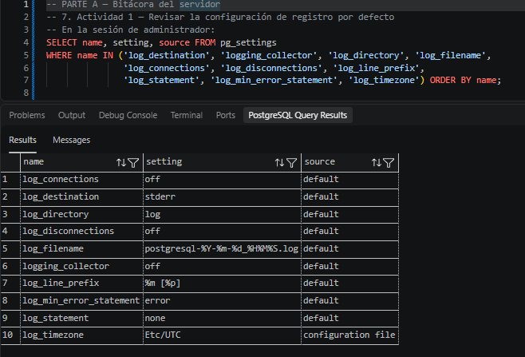

# Actividad 1 — Revisar la configuración de registro por defecto

## Evidencias de querys

## Preguntas de análisis

1. **Con esta configuración, ¿se registra quién se conecta?**
   No, porque `log_connections` está desactivado.

2. **¿Se registran las sentencias `UPDATE`?**
   No, porque `log_statement` está en `none`.

3. **¿La línea de bitácora incluye el usuario o la dirección IP del cliente?**
   No, únicamente registra la fecha/hora y el PID del proceso.

4. **¿En qué zona horaria se registran los eventos? ¿Por qué importa al reconstruir una cronología?**
   En `Etc/UTC`. Importa porque ofrece una referencia temporal única y estándar para correlacionar eventos sin ambigüedades por husos horarios o cambios de horario.

5. **Con `logging_collector = off`, ¿quién decide dónde termina la bitácora: PostgreSQL o el mecanismo con que se desplegó el servidor?**
   El mecanismo de despliegue del servidor, que en mi caso seria un contenedor de Docker.