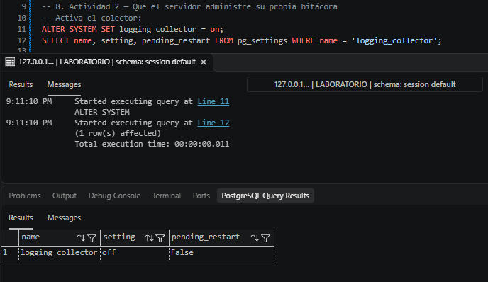
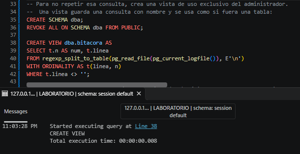
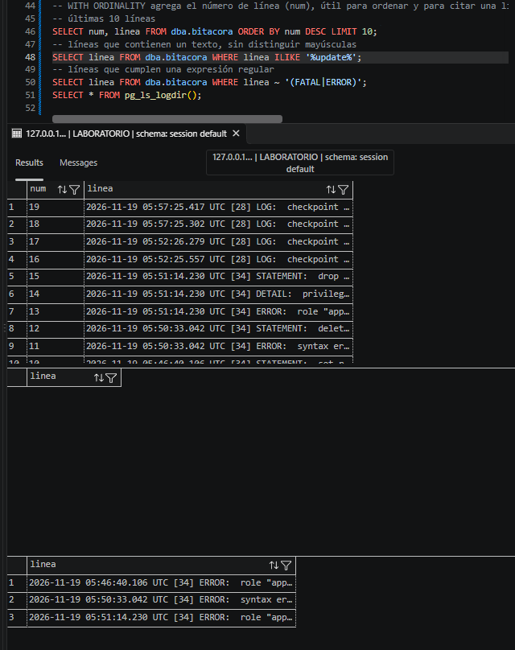

# Actividad 2 — Que el servidor administre su propia bitácora

## Evidencias de querys

## Preguntas de análisis

1. **¿Por qué `logging_collector` requiere reinicio y `log_statement` solo recarga?**
  Porque `logging_collector` crea un proceso secundario desde el arranque del servidor/contenedor, mientras que `log_statement` solo ajusta el nivel de registro de los procesos.

2. **¿Qué ventaja tiene que la bitácora se lea con SQL y no con una herramienta del sistema operativo o del contenedor? ¿Qué riesgo introduce?**
   Permite consultar y filtrar los eventos directamente desde el motor sin depender de herramientas del host ni permisos del sistema operativo, pero, puede leer cualquier archivo accesible para el usuario `postgres`(admin) del sistema operativo si se otorga a roles no confiables.

3. **¿Quién debería poder consultar `dba.bitacora`?**
   Únicamente el admin de la base de datos (`postgres`) o roles de auditoría autorizados bajo el principio de mínimo privilegio.