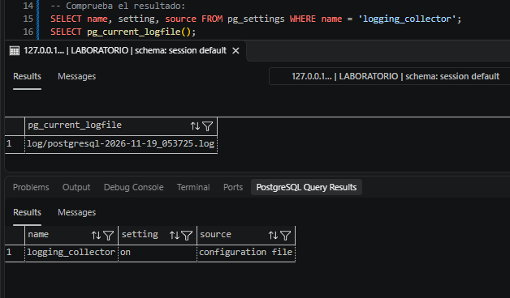
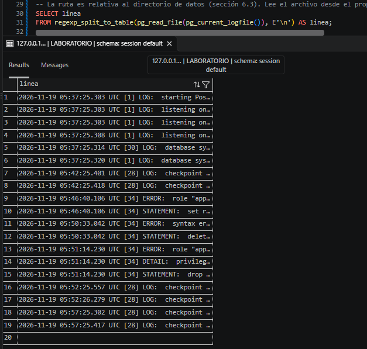
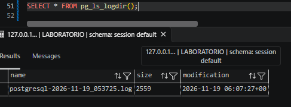

# Actividad 2 — Que el servidor administre su propia bitácora

### Extracto de lectura inicial desde `dba.bitacora`

```text

```

## Evidencias de querys







## 3. Preguntas de análisis

1. **¿Por qué `logging_collector` requiere reinicio y `log_statement` solo recarga?**
   >  

2. **¿Qué ventaja tiene que la bitácora se lea con SQL y no con una herramienta del sistema operativo o del contenedor? ¿Qué riesgo introduce?**
   >  

3. **¿Quién debería poder consultar `dba.bitacora`?**
   >  