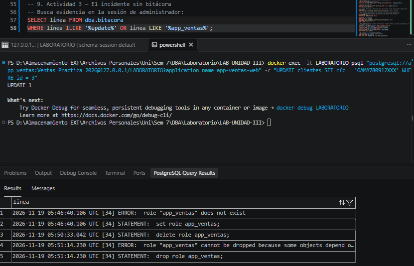

# Actividad 3 — El incidente sin bitácora

## Evidencias de querys

## 3. Preguntas de análisis

1. **¿Puedes demostrar quién modificó el RFC?**
   >  

2. **¿Puedes demostrar que el cambio no lo hizo `soporte_ana`?**
   >  

3. **Los privilegios de la Unidad II, ¿impidieron el cambio? ¿Debían impedirlo?**
   >  

4. **¿Qué tendría que haber estado configurado antes del incidente?**
   >  