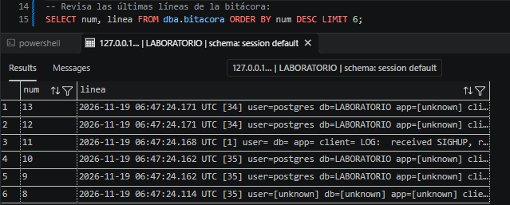

# Actividad 4 — Configurar la bitácora

## Evidencias de querys

## Preguntas de análisis

1. **¿Por qué el proceso que registra el cambio es el principal y no tu sesión?**
   Porque `pg_reload_conf()` envía una señal `SIGHUP` al proceso maestro (`postmaster`, PID `1`), encargado de releer la configuración y notificar los cambios al resto de procesos.

2. **¿Qué pasaría si alguien ejecutara `ALTER SYSTEM SET log_statement = 'none'`? ¿Quedaría rastro?**
   Sí quedaría rastro: el proceso principal registraría `parameter "log_statement" changed to "none"` al recargar, y además se registraría la propia sentencia `ALTER SYSTEM` si antes estaba en `ddl` o `mod`.

3. **¿Por qué no se recomienda editar `postgresql.auto.conf` a mano?**
   Porque es un archivo gestionado exclusivamente por `ALTER SYSTEM`; una edición manual con errores de sintaxis puede impedir que PostgreSQL recargue su configuración o arranque tras un reinicio.