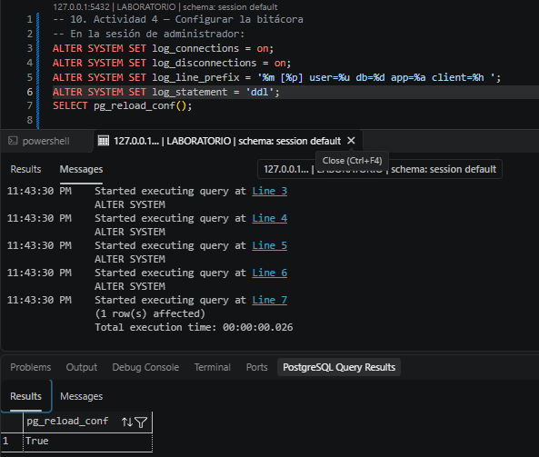
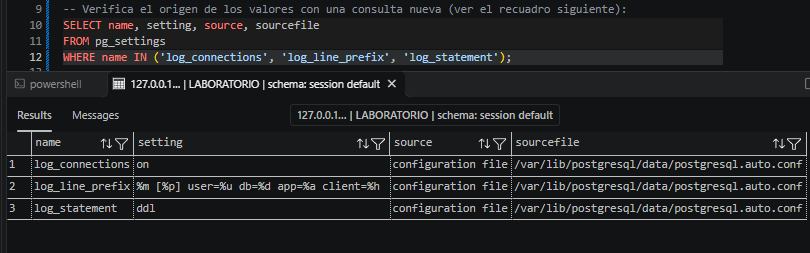

# Actividad 4 — Configurar la bitácora

## Evidencias de querys

## 3. Preguntas de análisis

1. **¿Por qué el proceso que registra el cambio es el principal y no tu sesión?**
   >  

2. **¿Qué pasaría si alguien ejecutara `ALTER SYSTEM SET log_statement = 'none'`? ¿Quedaría rastro?**
   >  

3. **¿Por qué no se recomienda editar `postgresql.auto.conf` a mano?**
   >  