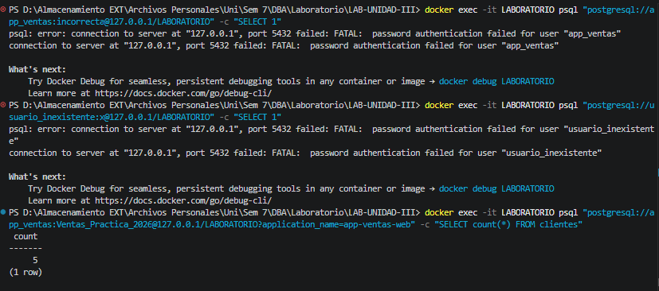

# Actividad 5 — Accesos exitosos y fallidos

### Desglose de una línea de acceso fallido (Sección 11.1)

| Campo | Valor observado | Significado |
| :--- | :--- | :--- |
| Fecha y hora | | |
| PID | | |
| Usuario | | |
| Base de datos | | |
| Aplicación | | |
| Cliente | | |
| Severidad | | |
| Mensaje | | |
| Regla aplicada | | |

## Evidencias de querys

## Preguntas de análisis

1. **La bitácora registra el usuario `app_ventas` en el intento fallido. ¿Eso prueba que la aplicación de ventas intentó entrar? ¿Qué prueba realmente?**
    No prueba que haya sido la aplicación legítima; solo demuestra que alguien desde `127.0.0.1` intentó conectarse usando el nombre de rol `app_ventas` sin conocer su contraseña.

2. **¿Qué información adicional registra PostgreSQL cuando el rol no existe? ¿Por qué aparece en la bitácora y no en el mensaje que recibe el cliente?**
    Registra en `DETAIL` que el rol no existe (`Role "usuario_inexistente" does not exist.`). Se oculta al cliente para evitar la enumeración de usuarios válidos.

3. **¿Por qué `app=[unknown]` en el intento fallido, pero `app=app-ventas-web` en la desconexión?**
    Porque `application_name` se asigna una vez superada la autenticación (`connection authorized`); al fallar la clave, la conexión se aborta antes de esa etapa.

4. **¿Qué patrón de varias líneas te haría sospechar de un ataque de fuerza bruta? Escribe la consulta que contaría los intentos fallidos por usuario.**
    Múltiples mensajes `FATAL: password authentication failed` consecutivos en un intervalo corto desde la misma IP (`client=`) o contra distintos roles.