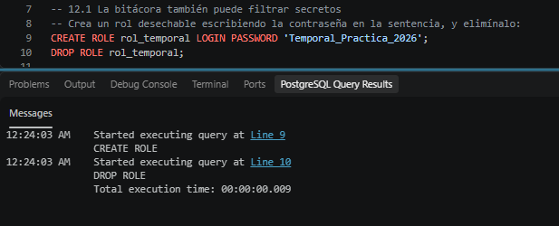
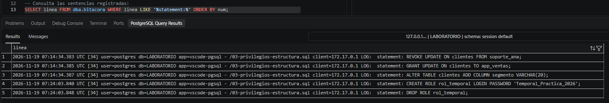

# Actividad 6 — Cambios de privilegios y de estructura

## Evidencias de querys

## 3. Preguntas de análisis

1. **¿Qué tipo de evento es cada una de las tres primeras sentencias (privilegio o estructura)?**
   >  

2. **¿Por qué `GRANT` y `REVOKE` quedan registrados con `log_statement = 'ddl'`?**
   >  

3. **Si la bitácora contiene contraseñas, ¿quién debería poder leerla? Relaciónalo con la gestión de secretos de la Unidad II.**
   >  