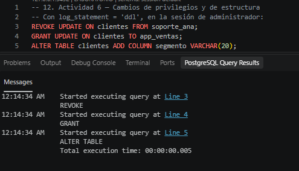

# Actividad 6 — Cambios de privilegios y de estructura

## Evidencias de querys

## Preguntas de análisis

1. **¿Qué tipo de evento es cada una de las tres primeras sentencias (privilegio o estructura)?**
    `REVOKE` y `GRANT` son eventos de **privilegio**; `ALTER TABLE` es un evento de **estructura**.

2. **¿Por qué `GRANT` y `REVOKE` quedan registrados con `log_statement = 'ddl'`?**
    Porque en PostgreSQL el nivel `ddl` incluye tanto la definición de objetos (`CREATE`, `ALTER`, `DROP`) como las sentencias de administración de permisos (`GRANT`, `REVOKE`).

3. **Si la bitácora contiene contraseñas, ¿quién debería poder leerla? Relaciónalo con la gestión de secretos de la Unidad II.**
    Únicamente el administrador autorizado o personal de auditoría bajo mínimo privilegio. Como se vio en la Unidad II, las credenciales nunca deben enviarse en texto claro en SQL (debe usarse `\password` o gestores de secretos) y deben redactarse antes de exportar o compartir bitácoras.