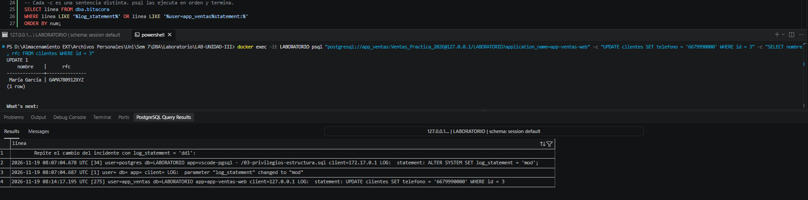

# Actividad 7 — Modificaciones de datos: `ddl` frente a `mod`

 ## Evidencias de querys

## Preguntas de análisis

1. **¿Qué nivel habría registrado la lectura del RFC? ¿Qué costo tendría en un servidor con miles de consultas por minuto?**
   El nivel `log_statement = 'all'`. En un entorno de alta carga generaría un volumen masivo de bitácora, saturación de escritura en disco (I/O) y exposición de datos sensibles consultados.

2. **¿Qué le falta a esta bitácora para revertir el cambio con certeza? (Lo resolverás en la Parte B.)**
   Conocer el **valor anterior** del campo `telefono` antes de ejecutarse el `UPDATE`.