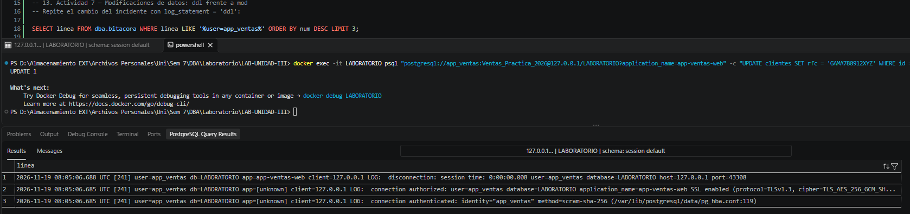

# Actividad 7 — Modificaciones de datos: `ddl` frente a `mod`

 ## Evidencias de querys

## 3. Preguntas de análisis

1. **¿Qué nivel habría registrado la lectura del RFC? ¿Qué costo tendría en un servidor con miles de consultas por minuto?**
   >  

2. **¿Qué le falta a esta bitácora para revertir el cambio con certeza? (Lo resolverás en la Parte B.)**
   >  