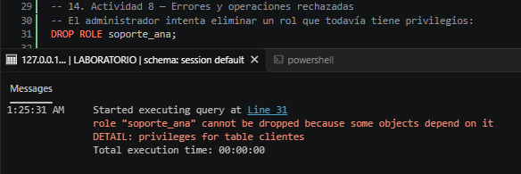
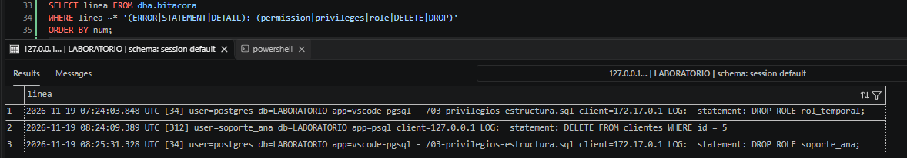

# Actividad 8 — Errores y operaciones rechazadas

## Evidencias de querys

## Preguntas de análisis

1. **¿El intento de `soporte_ana` causó algún daño? ¿Por qué debe auditarse de todos modos?**
  No causó daño porque el motor bloqueó el borrado, pero debe auditarse porque revela un intento no autorizado de manipulación o eliminación de datos por un usuario interno.

2. **¿Qué diferencia hay entre un error de autorización (esta actividad) y uno de autenticación (Actividad 5)?**
   El error de autenticación ocurre antes de abrir sesión por credenciales inválidas o rol inexistente; el de autorización ocurre con una sesión ya autenticada que intenta ejecutar una operación sin tener privilegios (`GRANT`).

3. **¿Qué indica el error de `DROP ROLE` sobre el orden correcto para dar de baja a un usuario?**
   Indica que antes de eliminar un rol con `DROP ROLE` es obligatorio revocar sus privilegios (`REVOKE`) y reasignar o eliminar cualquier objeto que dependa de él.