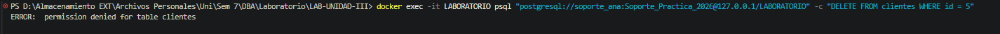

# Actividad 8 — Errores y operaciones rechazadas

## Evidencias de querys

## 3. Preguntas de análisis

1. **¿El intento de `soporte_ana` causó algún daño? ¿Por qué debe auditarse de todos modos?**
   >  

2. **¿Qué diferencia hay entre un error de autorización (esta actividad) y uno de autenticación (Actividad 5)?**
   >  

3. **¿Qué indica el error de `DROP ROLE` sobre el orden correcto para dar de baja a un usuario?**
   >  