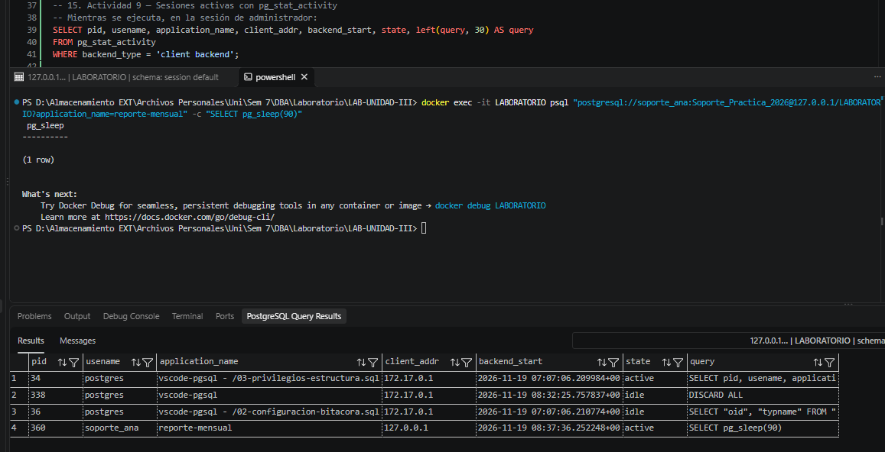

# Actividad 9 — Sesiones activas con `pg_stat_activity`

## Evidencias de querys

## Preguntas de análisis

1. **¿Qué columna permite relacionar una sesión con sus líneas de bitácora?**
    La columna `pid`, que corresponde al identificador de proceso entre corchetes (`[%p]`) configurado en `log_line_prefix`.

2. **Después de que termina el reporte, ¿qué fuente conserva evidencia de que existió?**
    La bitácora del servidor (`dba.bitacora`), ya que `pg_stat_activity` solo muestra las conexiones activas en el instante de la consulta.

3. **¿Por qué `client_addr` aparece vacío en la sesión del administrador?**
    Cuando el administrador se conecta mediante socket Unix local (`host=[local]`), no existe conexión TCP/IP y `client_addr` es `NULL` (en nuestro caso con VS Code y Docker aparece `172.17.0.1` porque la extensión se conecta por red a través del puente del contenedor).