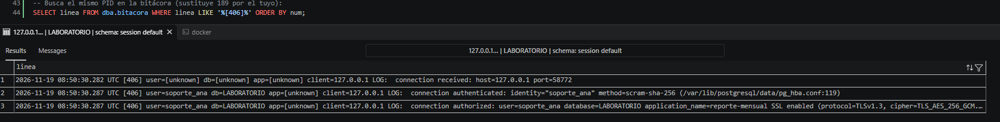

# Actividad 9 — Sesiones activas con `pg_stat_activity`

## 1. Comandos ejecutados

### Simulación de reporte de larga duración
```bash
psql "postgresql://soporte_ana:<REDACTED>@127.0.0.1/comercial?application_name=reporte-mensual" -c "SELECT pg_sleep(90)"
```

### Consulta de sesiones activas y correlación con bitácora
```sql
SELECT pid, usename, application_name, client_addr, backend_start, state, left(query, 30) AS query
FROM pg_stat_activity
WHERE backend_type = 'client backend';

SELECT linea FROM dba.bitacora WHERE linea LIKE '%[<PID>]%' ORDER BY num;
```

 

## 2. Resultado obtenido

### Estado durante la ejecución (`pg_stat_activity`)

| `pid` | `usename` | `application_name` | `client_addr` | `backend_start` | `state` | `query` |
| :--- | :--- | :--- | :--- | :--- | :--- | :--- |
| | | | | | | |

### Líneas correlacionadas en `dba.bitacora` y estado posterior al término

```text

```

## Evidencias de querys



## 3. Preguntas de análisis

1. **¿Qué columna permite relacionar una sesión con sus líneas de bitácora?**
   >  

2. **Después de que termina el reporte, ¿qué fuente conserva evidencia de que existió?**
   >  

3. **¿Por qué `client_addr` aparece vacío en la sesión del administrador?**
   >  