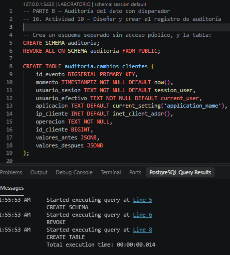

# Actividad 10 — Diseñar y crear el registro de auditoría

## Diseño del registro de auditoría (`auditoria.cambios_clientes`)

| Campo propuesto | Tipo | ¿Qué pregunta responde? | ¿Puede ser nulo? ¿Por qué? |
| :--- | :--- | :--- | :--- |
| `id_evento` | `BIGSERIAL` | | |
| `momento` | `TIMESTAMPTZ` | | |
| `usuario_sesion` | `TEXT` | | |
| `usuario_efectivo` | `TEXT` | | |
| `aplicacion` | `TEXT` | | |
| `ip_cliente` | `INET` | | |
| `operacion` | `TEXT` | | |
| `id_cliente` | `BIGINT` | | |
| `valores_antes` | `JSONB` | | |
| `valores_despues` | `JSONB` | | |

## Evidencias de querys

## Preguntas de análisis

1. **¿Por qué `momento` usa `TIMESTAMPTZ` y no `TIMESTAMP`?**
    Porque `TIMESTAMPTZ` almacena el instante exacto en UTC y lo ajusta automáticamente a la zona horaria de consulta, evitando ambigüedades por cambios de horario o ubicación.

2. **¿Por qué se guarda el registro completo en `JSONB` y no solo la columna que cambió?**
    Porque captura una fotografía completa de la fila en ese momento, permitiendo auditar cualquier columna modificada incluso si la estructura de `clientes` cambia en el futuro.

3. **La tabla de auditoría también contendrá RFC. ¿Qué implica eso para su clasificación y su control de acceso?**
    Contiene datos personales sensibles (PII), por lo que debe clasificarse como confidencial y restringirse en un esquema privado (`auditoria`) sin acceso para `PUBLIC` ni roles operativos.