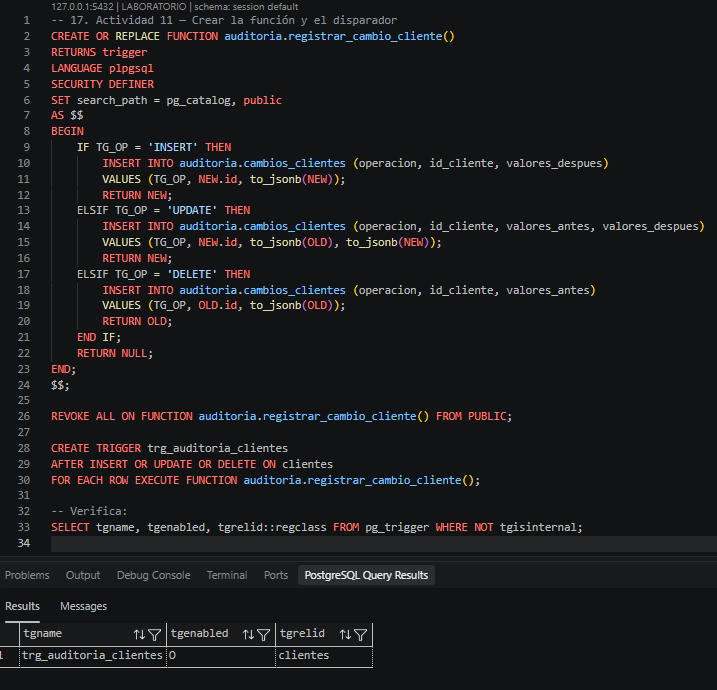
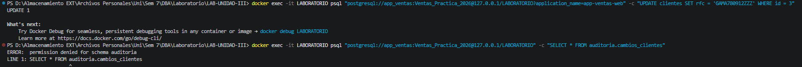
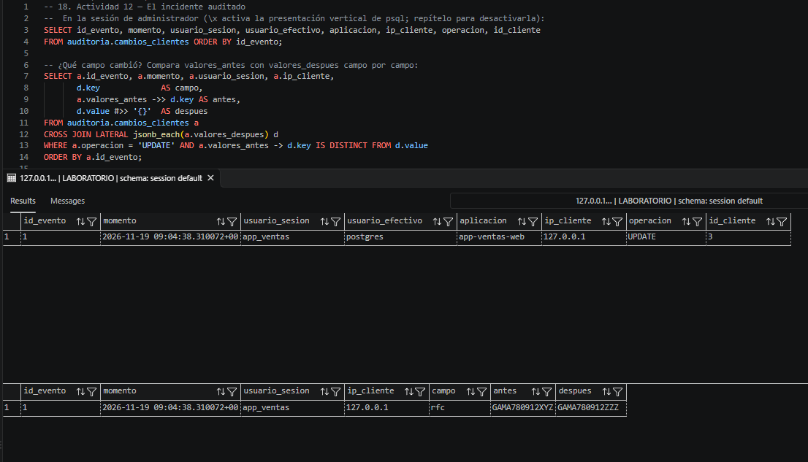

# Incidente auditado

## Actividad 11 — Crear la función y el disparador

## Evidencias de querys

### 2. Preguntas de la Actividad 11

1. **¿Por qué se ejecuta `REVOKE ALL ON FUNCTION ... FROM PUBLIC` si el disparador seguirá funcionando para `app_ventas`?**
   >  

2. **¿Qué pasaría si la función no fuera `SECURITY DEFINER`? Formula una hipótesis antes de la Actividad 12.**
   >  

3. **Consulta `dba.bitacora`. ¿Quedó registrada la creación del esquema, la tabla, la función y el disparador? ¿Por qué?**
   >  

 

## Actividad 12 — El incidente auditado

### Evidencias de querys

### Preguntas de la Actividad 12

1. **Compara tu hipótesis de la Actividad 11 con este resultado.**
   >  

2. **Escribe la sentencia `UPDATE` que restauraría el valor anterior.**
   >  

3. **¿Qué columna conserva más valor para una investigación: `aplicacion` o `ip_cliente`? ¿Cuál puede falsificar el cliente con más facilidad?**
   >  