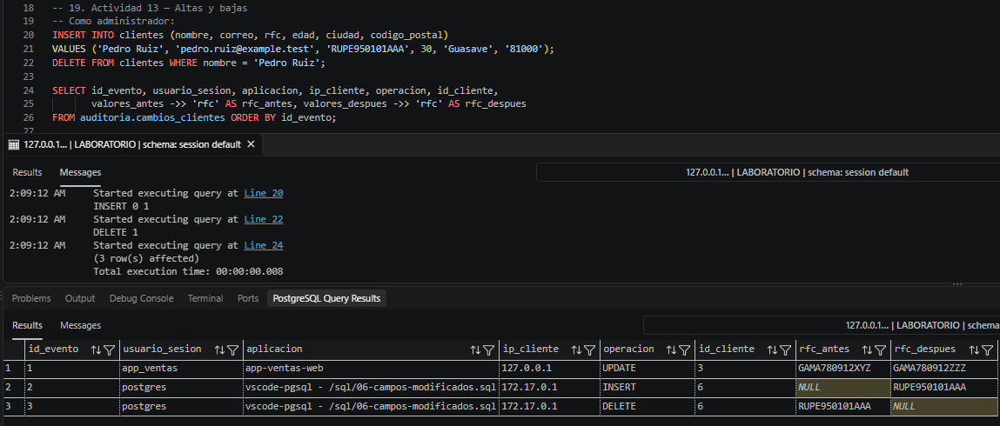

# Actividad 13 — Altas y bajas

### Evidencias de querys

## Preguntas de análisis

1. **El cliente Pedro Ruiz ya no existe en `clientes`. ¿Dónde queda evidencia de que existió y de sus datos?**
    En `auditoria.cambios_clientes` (eventos `2` y `3`), donde sus datos completos permanecen guardados en `valores_despues` (del `INSERT`) y `valores_antes` (del `DELETE`).

2. **¿Por qué `ip_cliente` está vacía en los eventos 2 y 3?**
    En el ejemplo de la guía aparece vacía (`NULL`) porque el administrador se conecta por socket Unix local sin red TCP/IP (en nuestro entorno con VS Code y Docker se registra `172.17.0.1` porque la extensión conecta por TCP a través de la red puente del contenedor).

3. **La política de retención de la Unidad II pedía eliminar datos cuando ya no fueran necesarios. ¿Qué conflicto aparece? ¿Quién debe resolverlo?**
   Surge un conflicto entre la supresión/minimización de datos personales y la obligación de conservar evidencia íntegra de auditoría. Debe resolverlo el oficial de cumplimiento o responsable de gobierno de datos mediante reglas de retención diferenciadas o anonimización.