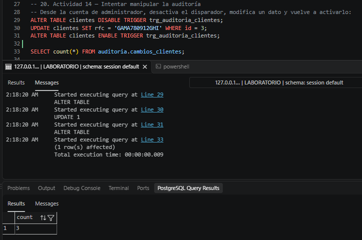

# Actividad 14 — Intentar manipular la auditoría

### Evidencias de querys

 

## Preguntas de análisis

1. **¿Qué evidencia permite detectar que hubo un cambio sin auditar?**
    Las sentencias `ALTER TABLE clientes DISABLE TRIGGER`, el `UPDATE` intermedio y `ENABLE TRIGGER` registradas en la bitácora del servidor (`dba.bitacora`, líneas 195-197).

2. **¿Qué control administrativo (no técnico) reduciría este riesgo?**
   Un procedimiento formal de control de cambios con autorización previa, revisión periódica de bitácoras por un auditor independiente y envío automático de logs a un servidor externo.

3. **Relaciona esta actividad con el principio de separación de funciones de la Unidad II.**
    Confirma que el DBA operativo (`postgres`) no debe tener control exclusivo sobre la custodia de las bitácoras, ya que posee privilegios para desactivar controles internos dentro del motor.