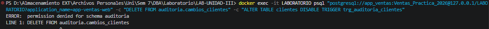
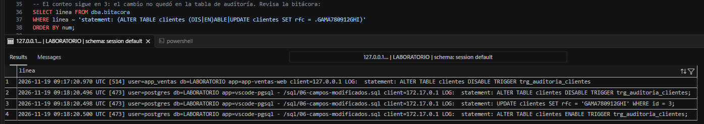

# Actividad 14 — Intentar manipular la auditoría

### Evidencias de querys

 

## Preguntas de análisis

1. **¿Qué evidencia permite detectar que hubo un cambio sin auditar?**
   >  

2. **¿Qué control administrativo (no técnico) reduciría este riesgo?**
   >  

3. **Relaciona esta actividad con el principio de separación de funciones de la Unidad II.**
   >  