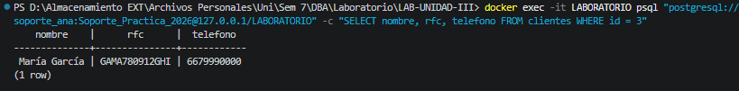
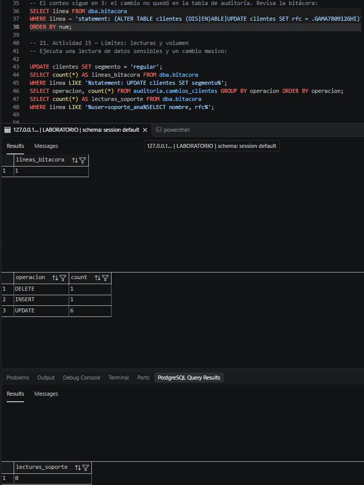

# Actividad 15 — Límites: lecturas y volumen

### Evidencias de querys

##  Preguntas de análisis

1. **Si `clientes` tuviera un millón de registros, ¿qué ocurriría con la auditoría tras un `UPDATE` sin `WHERE`?**
   >  

2. **Propón quién podría autorizar la depuración de `auditoria.cambios_clientes`.**
   >  

3. **¿Por qué `log_statement = 'all'` puede convertir la bitácora en un nuevo depósito de datos sensibles?**
   >  