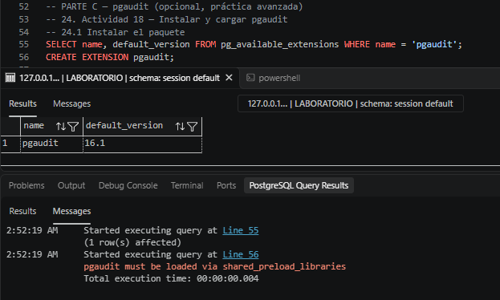
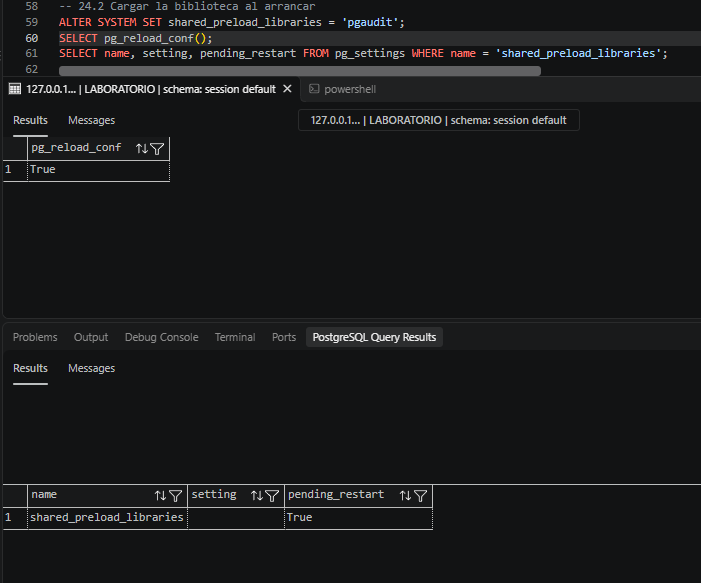
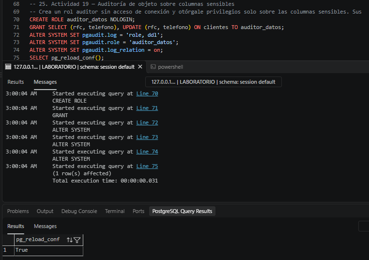
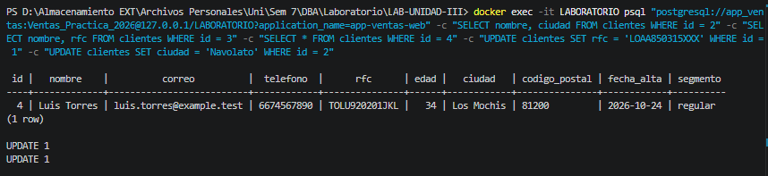
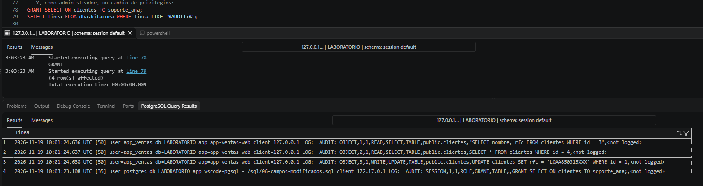

# Actividades 18 y 19 — Auditoría de objeto sobre columnas sensibles con `pgaudit` (Parte C)

### Evidencias de querys

## Preguntas de análisis

1. **¿Por qué no apareció `SELECT nombre, ciudad ...`? ¿Por qué sí apareció `SELECT * ...`?**
    `SELECT nombre, ciudad` no se auditó porque `auditor_datos` solo tiene privilegios sobre `rfc` y `telefono`. `SELECT *` sí se auditó porque expande todas las columnas de `clientes`, accediendo a las columnas sensibles.

2. **¿Por qué no apareció `UPDATE ... ciudad ...`?**
    Porque la actualización solo afectó la columna `ciudad`, sobre la cual `auditor_datos` no tiene privilegios de auditoría asignados.

3. **¿Qué diferencia de volumen esperarías frente a `log_statement = 'all'`?**
    Un volumen mucho menor, ya que la auditoría de objeto registra únicamente las operaciones sobre columnas sensibles definidas, omitiendo consultas sobre datos no críticos.

4. **El README oficial advierte que `pgaudit` no puede auditar de forma confiable a los superusuarios (REF-U3-09). ¿Qué implica para la separación de funciones?**
    Implica que un superusuario puede evadir o desactivar la extensión; por ello, las tareas operativas deben ejecutarse con roles sin privilegios de superusuario y las bitácoras deben enviarse a un repositorio externo independiente.