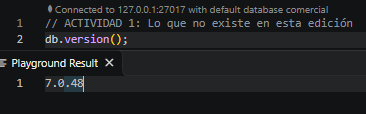
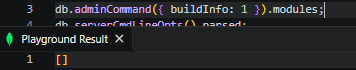
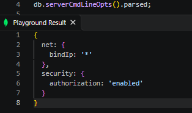

# Actividad 1 — Lo que no existe en esta edición

## Evidencias de comandos

## Preguntas de análisis

1. **¿Qué edición de MongoDB estás usando? ¿Qué evidencia lo demuestra?**  
   **MongoDB 7 Community Edition.** Lo demuestra `buildInfo.modules` devolviendo `[]` (en Enterprise incluye `"enterprise"`) y la ausencia de opciones como `--auditDestination`.

2. **¿A dónde escribe tu servidor su bitácora? ¿Cómo lo sabes?**  
   A la **salida estándar (`stdout`)** del contenedor y a un búfer circular en RAM de **1,024 eventos** (`getLog: "global"`). Se comprueba porque `db.serverCmdLineOpts().parsed` no define `systemLog.destination: file`.

3. **Según REF-U3-04, ¿qué cuatro categorías de eventos registraría la auditoría nativa?**  
   - Cambios de esquema (DDL).  
   - Eventos de conjuntos de réplicas y clústeres fragmentados.  
   - Autenticación y autorización.  
   - Operaciones CRUD (con `auditAuthorizationSuccess: true`).

4. **¿Qué tendría que evaluar una organización antes de licenciar Enterprise o migrar a Atlas solo para obtener auditoría?**  
   - **Cumplimiento normativo:** si leyes o estándares (LFPDPPP, PCI-DSS, ISO 27001) exigen pistas de auditoría inmutables.  
   - **Costo vs. riesgo:** costo de licencias/suscripción frente al impacto de no atribuir incidentes.  
   - **Desempeño y retención:** en Community el nivel 2 penaliza la latencia y sobrescribe evidencia al llenar 1 MB; la auditoría nativa escribe flujos externos (`JSON`/`BSON`/`syslog`).