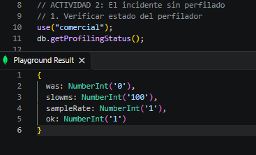
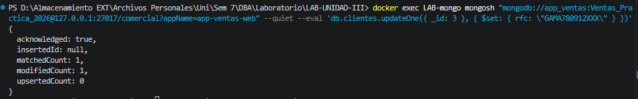
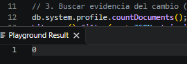
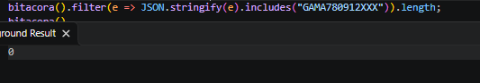
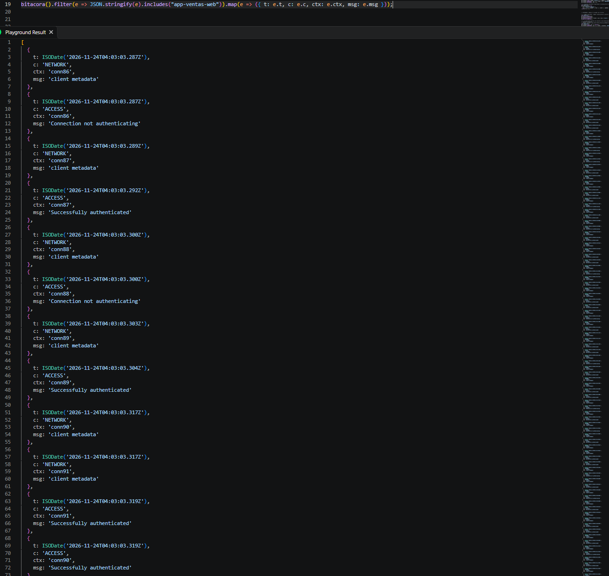

# Actividad 2 — El incidente sin perfilado

## Evidencias de comandos

## 3. Preguntas de análisis

1. **¿Puedes demostrar qué cambió? ¿Y quién se conectó a esa hora?**  
   * **Qué cambió:** **No hay evidencia con esta edición.** Con el perfilador apagado (`was: 0`), `system.profile` está vacío y la bitácora de Community no registra sentencias CRUD ni valores modificados.  
   * **Quién se conectó:** **Sí.** La bitácora confirma que `app_ventas@comercial` se autenticó desde `172.17.0.1` (`conn202`) a las `04:35:44.976Z` con `app-ventas-web`, pero sin vincularlo con la operación ejecutada.

2. **¿Por qué `mongosh` abre varias conexiones (`conn201`, `conn202`, ...) para una sola instrucción? ¿Cuál es la que se autentica?**  
   El driver abre un pool separado: una conexión de monitoreo de topología (`conn201`, que intercambia `client metadata` y cierra sin autenticarse) y una conexión de operaciones (`conn202`), que es la que realiza el handshake `SCRAM-SHA-256` (`Successfully authenticated`).