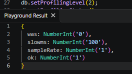
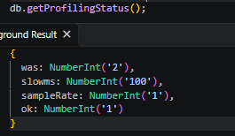
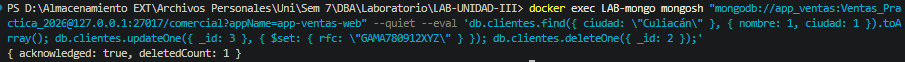
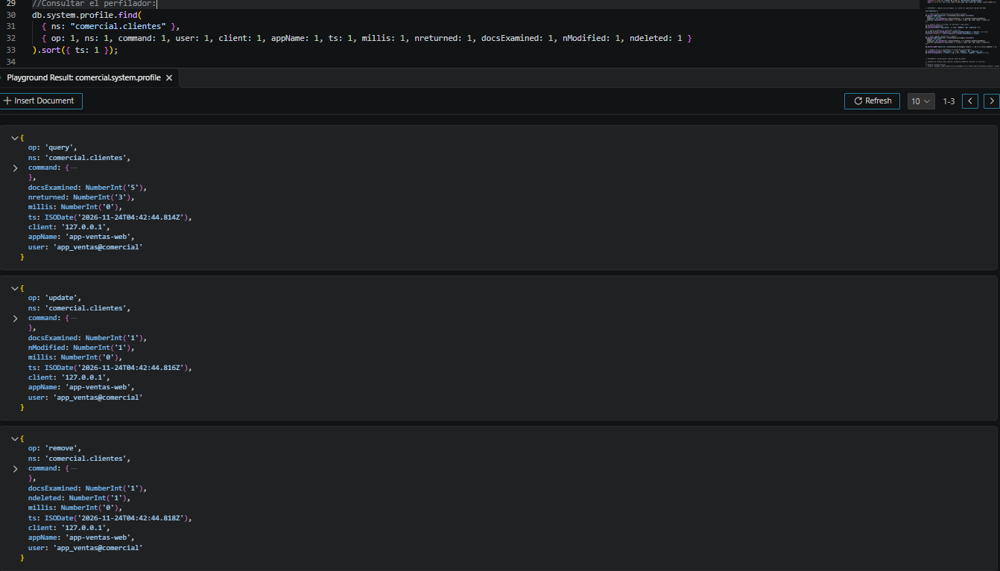

# Actividad 3 — Activar el perfilador y registrar operaciones

## Evidencias de comandos

### Tabla 9.1 — Interpretar los documentos

| # | `op` | Usuario | Cliente | Aplicación | Momento (UTC) | Qué hizo | Documentos afectados |
| :--- | :--- | :--- | :--- | :--- | :--- | :--- | :--- |
| **1** | `query` | `app_ventas@comercial` | `127.0.0.1` | `app-ventas-web` | `2026-10-25T22:52:45.906Z` | `find` en `comercial.clientes` (`ciudad: "Culiacán"`, proyección `{ nombre: 1, ciudad: 1 }`) | `nreturned: 3` (`docsExamined: 5`) |
| **2** | `update` | `app_ventas@comercial` | `127.0.0.1` | `app-ventas-web` | `2026-10-25T22:52:45.909Z` | `update` en `comercial.clientes` (`{ _id: 3 }`) con `$set: { rfc: "GAMA780912XYZ" }` | `nModified: 1` (`docsExamined: 1`) |
| **3** | `remove` | `app_ventas@comercial` | `127.0.0.1` | `app-ventas-web` | `2026-10-25T22:52:45.915Z` | `remove` en `comercial.clientes` (`{ _id: 2 }`, `limit: 1`) | `ndeleted: 1` (`docsExamined: 1`) |

## Respuestas

1. **¿Puedes saber cuál era el RFC antes del cambio con la información de `system.profile`?**  
   **No hay evidencia con esta edición.** El perfilador solo registra el comando recibido (`$set`), no la imagen previa (*before-image*) del documento.

2. **¿Puedes saber qué datos tenía el documento eliminado?**  
   **No hay evidencia con esta edición.** Solo se registra el criterio de filtrado (`command.q: { _id: 2 }`), no el contenido del documento borrado.

3. **A diferencia de `log_statement = 'mod'` en PostgreSQL, el nivel 2 sí registró la consulta. ¿Qué ventaja y qué riesgo tiene eso?**  
   * **Ventaja:** permite detectar lecturas no autorizadas o exfiltración de datos.  
   * **Riesgo:** degrada el rendimiento, satura rápidamente el límite de 1 MB de `system.profile` y expone datos personales presentes en los filtros de búsqueda (`command.filter`) en texto claro.

4. **¿Por qué el campo `user` incluye `@comercial`?**  
   Porque en MongoDB los usuarios se identifican como `<usuario>@<base_de_autenticacion>`, y `app_ventas` fue creado dentro de la base `comercial`.