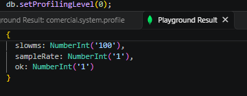
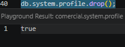
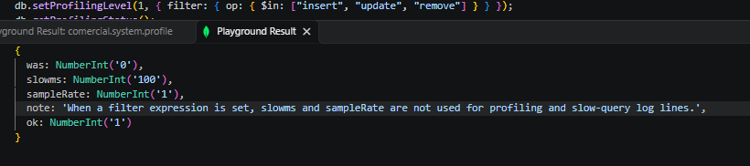
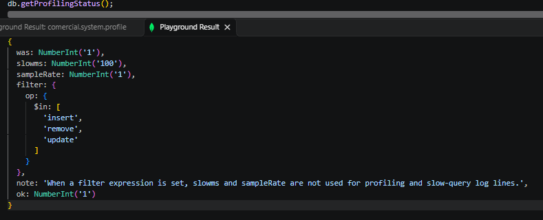
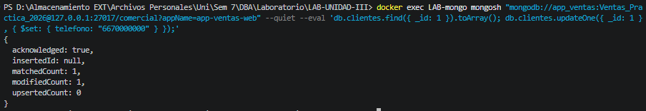
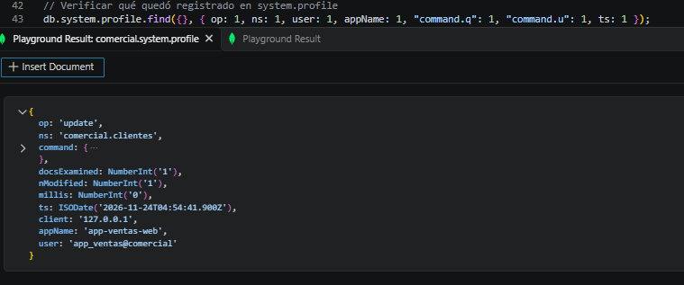

# Actividad 4 — Reducir el volumen con un filtro

## Evidencias de comandos








## Preguntas de análisis

1. **¿Qué perdiste de evidencia al aplicar el filtro? ¿Qué ganaste?**  
   * **Se perdió:** visibilidad sobre lecturas (`query`, `aggregate`, `count`) y comandos administrativos, además de desactivarse el registro de consultas lentas por `slowms`.  
   * **Se ganó:** menor impacto en rendimiento y mayor tiempo de retención dentro del límite de 1 MB de `system.profile`, evitando que las lecturas sobrescriban las modificaciones.

2. **¿Qué filtro usarías si solo interesaran operaciones sobre la colección `clientes`?**  
   ```javascript
   db.setProfilingLevel(1, { filter: { ns: "comercial.clientes" } })
   ```