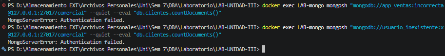
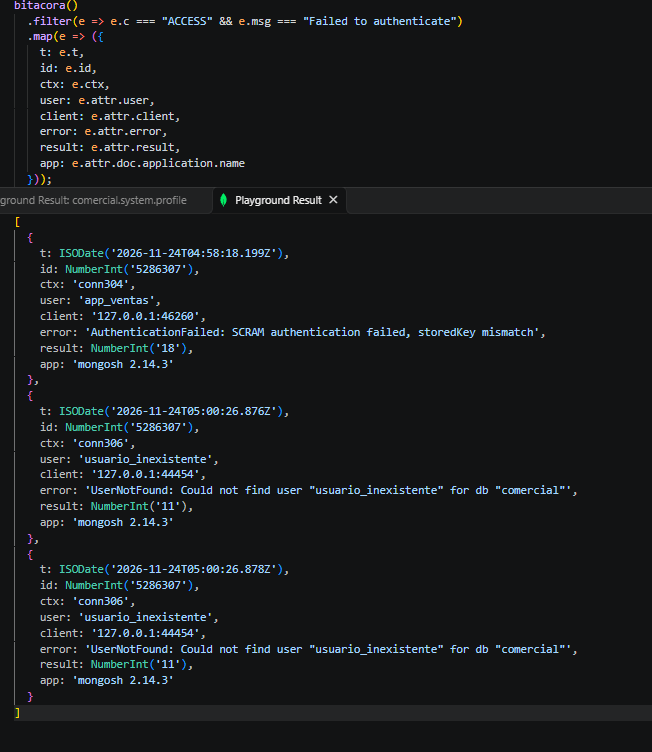
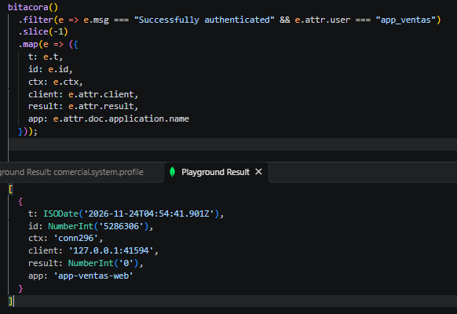

# Actividad 5 — Accesos en la bitácora de `mongod`

## Evidencias de comandos

## 3. Preguntas de análisis

1. **¿Qué campo distingue un acceso fallido de uno exitoso?**  
   El campo **`msg`** (`"Failed to authenticate"` vs. `"Successfully authenticated"`), junto con **`id`** (`5286307` vs. `5286306`) y **`attr.result`** (distinto de `0` vs. `0`).

2. **¿Qué diferencia hay entre el error de contraseña incorrecta y el de usuario inexistente? ¿Por qué el cliente recibe el mismo mensaje en ambos casos?**  
   En la bitácora se distinguen como `SCRAM authentication failed, storedKey mismatch` (`result: 18`) y `UserNotFound` (`result: 11`). Al cliente se le envía el mismo mensaje genérico (`Authentication failed`) para evitar la **enumeración de usuarios** válidos.

3. **¿Por qué el nombre de la aplicación del intento fallido es `mongosh 2.10.0` y no `app-ventas-web`?**  
   Porque en la cadena de conexión de prueba se omitió el parámetro `?appName=app-ventas-web`, por lo que el cliente envió su nombre predeterminado (`mongosh 2.10.0`).
   > 