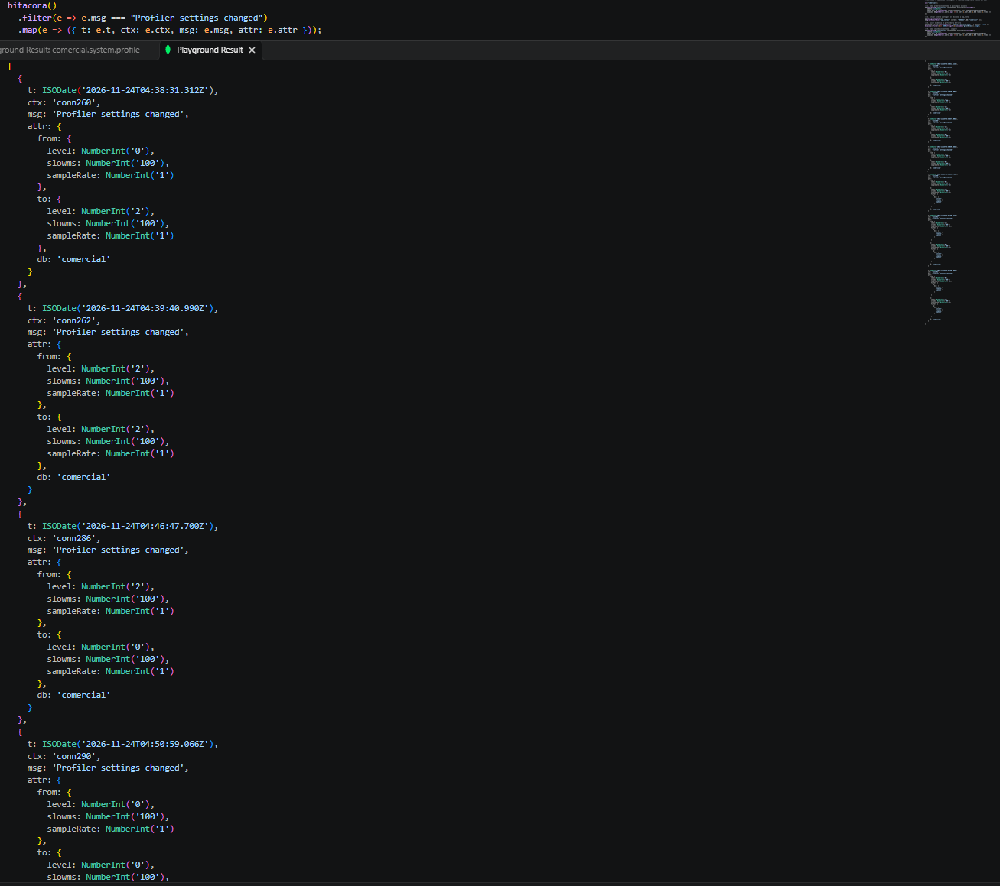
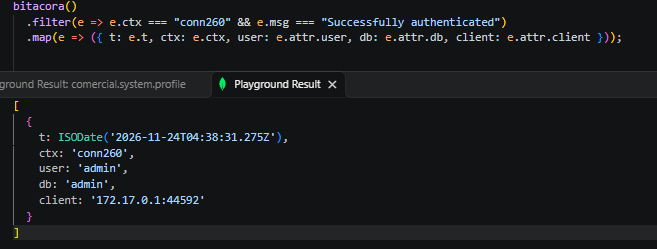

# Actividad 6 — Correlacionar un cambio de configuración con su autor

## Evidencias de comandos

## Preguntas de análisis

1. **¿Qué usuario cambió la configuración del perfilador? ¿Qué dos eventos lo demuestran?**  
   El usuario **`admin@admin`** desde `172.17.0.1:55948`. Lo demuestran `Successfully authenticated` (`id: 5286306`) y `Profiler settings changed` (`id: 48742`) compartiendo el mismo identificador **`ctx: "conn292"`**.

2. **¿Qué condición debe cumplirse para que esta correlación sea válida?**  
   Que ambos eventos ocurran dentro del **mismo ciclo de ejecución (*uptime*)** sin reinicios del servidor, ya que los contadores `connN` se reinician en `conn1` al arrancar `mongod`.

3. **¿Por qué es relevante que quede registrado un cambio de configuración del propio mecanismo de registro?**  
   Para detectar intentos de **evasión de auditoría (*anti-forensics*)**, identificando quién apagó o alteró el perfilador y durante qué ventana de tiempo hubo ceguera de registro.