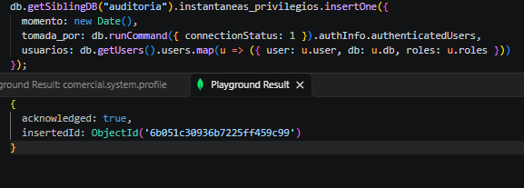
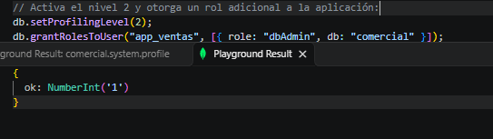
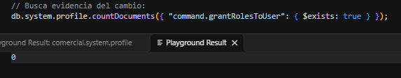
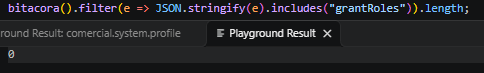
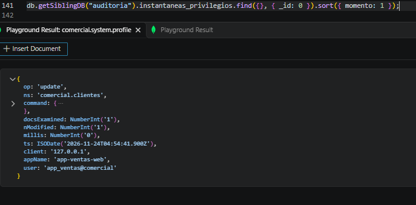
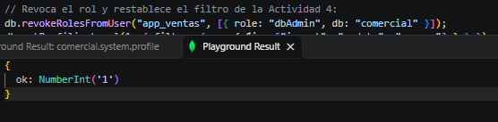
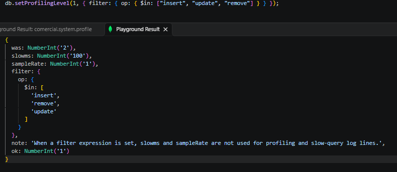

# Actividad 7 — Cambios de privilegios: el límite más importante

## Evidencias de comandos

### Evaluación del alcance de las instantáneas

| Pregunta | ¿La instantánea responde? | Detalle |
| :--- | :--- | :--- |
| **¿Cambiaron los privilegios de `app_ventas`?** | **Sí** | Comparando el arreglo `roles` entre dos tomas. |
| **¿Qué rol se agregó?** | **Sí** | Se detecta `{ role: "dbAdmin", db: "comercial" }`. |
| **¿Quién lo agregó?** | **No** | **No hay evidencia con esta edición.** |
| **¿Cuándo exactamente?** | **No** | Solo acota el intervalo entre dos instantáneas. |

## Preguntas de análisis

1. **¿Por qué un cambio de privilegios es uno de los eventos auditables más importantes?**  
   Porque una escalada de privilegios (`dbAdmin`, `userAdmin`, `root`) permite eludir restricciones de acceso, borrar datos, alterar controles de seguridad o crear cuentas administrativas no autorizadas.

2. **¿Con qué frecuencia tomarías instantáneas? ¿Qué factores influyen?**  
   Cada **15 a 60 minutos** en producción mediante tarea automatizada con alertas de diferencias (`diff`). Influyen la sensibilidad de los datos, la cantidad de administradores, la frecuencia de cambios autorizados y el tiempo máximo tolerable de detección (RPO).

3. **¿Quién debería poder escribir en `auditoria.instantaneas_privilegios`?**  
   Solo una **cuenta de servicio automatizada** con permiso exclusivo de `insert`, revocando `update`/`delete` a los DBA y exportando las instantáneas a un almacenamiento externo inmutable.

4. **Redacta en tres líneas cómo comunicarías esta limitación a Dirección.**  
   > MongoDB Community Edition no registra de forma nativa qué usuario ni cuándo modifica los permisos en la base de datos. Para mitigar este riesgo, implementamos instantáneas periódicas automatizadas que detectan alteraciones de roles dentro de una ventana acotada. Si se requiere atribución exacta e inmutable en tiempo real por cumplimiento normativo, es necesario migrar a MongoDB Enterprise o Atlas.
   > 