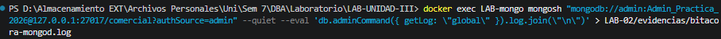
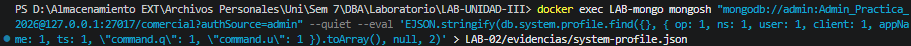
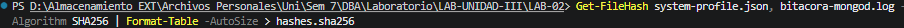
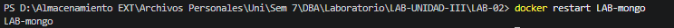
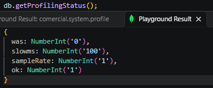
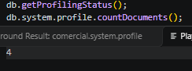
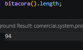

# Actividad 8 — Conservación: exportar antes de perder

## Evidencias de comandos

## 3. Preguntas de análisis

1. **Menciona tres formas en que la evidencia del perfilador o de la bitácora puede perderse sin que nadie la borre deliberadamente.**  
   - **Sobrescritura circular en `system.profile`:** al llenarse su límite de 1 MB (*capped collection*), sobrescribe los documentos más antiguos.  
   - **Reinicio de `mongod`:** vacía el búfer en RAM de `getLog` (1,024 eventos) y devuelve el perfilador a nivel `0` si no está en `mongod.conf`.  
   - **Truncamiento o contenedor efímero:** reiniciar sin `systemLog.logAppend: true` sobrescribe el archivo de log, y recrear un contenedor sin volúmenes destruye ambos registros.

2. **¿Por qué el tamaño de 1 MB de `system.profile` es un problema de conservación y no solo de espacio?**  
   Porque determina directamente la **ventana temporal de retención**: bajo carga alta o en nivel 2, 1 MB se llena en minutos o segundos, destruyendo la evidencia antes de que pueda investigarse.

3. **¿Por qué `getLog` sirve para interpretar pero no para conservar?**  
   Porque lee un **búfer volátil en memoria RAM** limitado a los últimos **1,024 eventos**, el cual descarta registros antiguos continuamente y se pierde por completo al reiniciar el servidor.